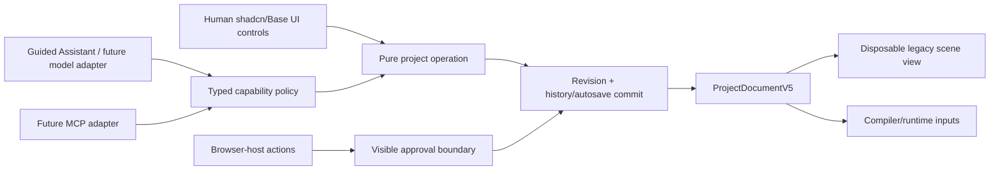

# ThreeJS Studio — AI Authoring Architecture

## Status and invariant

Human/AI authoring parity is a shipping requirement. A project feature is not complete when it exists only as a React callback, an Inspector control, or a direct Three.js mutation.

`ProjectDocumentV5` is now the editor's authoritative durable document. The mounted scene editor still consumes a schema-v4 compatibility view, so the repository temporarily exposes three related capability layers:

1. The original editor capability manifest operates on the v4 scene view and is integrated with Guided Assistant and the trusted same-page bridge.
2. `AGENT_ENGINE_CAPABILITY_MANIFEST` is a pure compatibility contract whose source type is v4. It tests the atomic v4 command executor and v4→v5 projection/build-readiness helpers; it is not evidence that v4 remains the durable document.
3. `AGENT_GAME_CAPABILITY_MANIFEST` operates directly on validated v5 projects for scripts, the Collect & Escape template, and build profiles.

For every authorable feature:

1. Durable state belongs in `ProjectDocumentV5` or a stable asset/source reference.
2. Human and agent entry points reuse the same pure project operation.
3. Every tool declares an input schema, description, scope, effect, approval policy, and availability.
4. Arguments are validated before execution and the complete project is validated after execution.
5. Mutations use optimistic revisions and enter normal history, logging, autosave, and Undo.
6. Multi-operation work is atomic; a failed plan applies nothing.
7. Contract tests compare human and agent results and prove one-step Undo.
8. Runtime and browser objects never cross the authoring boundary.

System-owned hashes, revisions, timestamps, import diagnostics, and generated IDs can be inspected but are changed only by their owning operation.

## Trust boundaries

- Project APIs contain only finite, JSON-compatible data and stable references.
- `Object3D`, renderer, canvas, DOM, React state, IndexedDB handles, `File`, object URLs, audio nodes, physics objects, and browser handles are never project-tool values.
- Play uses derived runtime state. Runtime/save-game state cannot mutate authored data.
- File selection, code changes/execution, permission changes, destructive operations, and external communication require visible human review.
- Provider/model logic stays outside the editor core. The Guided Assistant, a future provider, and an MCP adapter should consume the same manifest/executor.

## Authoritative v5 document and compatibility scene view

`src/App.tsx` stores the authoritative v5 project in `gameProjectRef`. Save/autosave, portable project packages, Undo/Redo snapshots, script authoring, builds, the bridge snapshot, and template creation use this document.

`src/editor/gameProject.ts` provides the transition boundary:

- v1–v4 documents load through their strict loaders and migrate to v5.
- v5 documents fail closed when malformed; they do not fall through to legacy migration.
- `createLegacySceneView` derives the active scene for the existing Hierarchy, Inspector, and viewport.
- `syncLegacySceneToV5` merges legacy scene edits back without discarding other scenes, non-model assets, prefabs, UI documents, or generalized bindings. Projected `axis2d` controls retain dead zones and non-keyboard bindings; non-projectable `button` and `axis1d` actions remain exact and ordered. Hidden-action ID collisions fail before mutation.

This adapter keeps existing controls working, but new v5 domains must not be flattened through the scene view.

## Legacy editor capability layer

`AGENT_CAPABILITY_MANIFEST` publishes protocol `threejs-studio.authoring` version 1. Its pure tools cover scene inspection, primitives/groups, node updates and hierarchy, duplication/deletion, material/world changes, existing model instancing, Rotate/Float/Keyboard Move, and keyboard-first Input Actions. Browser-host tools cover selection, viewport/runtime controls, history, console, layout, save/import/export/build, and user-mediated file requests.

The deterministic Guided Assistant prepares typed calls for review, validates a pure plan, and commits an accepted plan as one Undo step. When these tools change the legacy scene view, the normal App commit path merges that change into authoritative v5.

The global same-page bridge is intended for trusted code already running in the editor page. Its scope strings are descriptive metadata, not authenticated grants. It is neither a remote authorization boundary nor an MCP server.

## V4 command compatibility contract

`src/editor/projectCommands.ts` implements `threejs-studio.project-commands` version 1 for the existing schema-v4 scene domains. It provides strict serializable envelopes, optimistic revisions, cloned execution, pre/post validation, atomic batches, stable errors, affected records, bounded change paths, patches, and inverse snapshots.

`AGENT_ENGINE_CAPABILITY_MANIFEST` wraps five pure compatibility tools around that executor and v5-readiness/build-profile projection. It is machine-marked `legacy-compatibility`, names v5 as the authoritative mounted schema, and points to `threejs-studio.game-authoring` as its successor. Its metadata intentionally declares source schema 4 and projection schema 5 because the function accepts a v4 scene document. In the mounted editor, that source is the disposable compatibility view—not the durable project.

The v4 executor is not yet the universal App commit path, and it cannot author v5-only records. A v5-native command registry is still required for scenes, prefabs, generalized assets/input, scripts, variables/events, runtime UI, permissions, and build profiles.

## V5 game capability layer

`AGENT_GAME_CAPABILITY_MANIFEST` is machine-marked `authoritative` and publishes `threejs-studio.game-authoring` version 1 with seven tools:

- `studio_list_scripts` and `studio_get_script`.
- `studio_upsert_script` and `studio_delete_script`.
- `studio_create_collect_escape`.
- `studio_list_game_build_profiles`.
- `studio_prepare_game_build`.

Each call validates the complete v5 project, requires the observed revision, returns stable errors, and contains only serializable data. Mutations return the next project plus an inverse v5 snapshot and a single history label. `upsertProjectScript` is the same pure operation used by Monaco Save, and parity tests compare both routes.

Executable-code writes, deletion, whole-project replacement, and artifact creation require approval. Build preparation itself is read-only and approval-free; it returns a descriptor whose later artifact-producing host action requires review. In the current same-page bridge, read-only and preparation tools complete immediately. Approval-required mutation tools create a serializable Assistant proposal, return `approval_required`, and can be applied through the visible proposal UI only while its base revision remains current. Apply commits the returned v5 project through normal validation, history, autosave, events, and one-step Undo. Human Monaco Save uses the same project operation behind a focused code-review dialog.

The canonical bridge is API version 2. Its manifest reports schema 5 as authoritative and nests the game-authoring manifest. Its snapshot returns the v5 project as `project`, plus an explicitly named `legacySceneProjection` for consumers migrating from the former V1 snapshot shape. The version was incremented because changing `snapshot().project` from V4 to V5 is a breaking payload change.

## Capability matrix

Status terms:

- **Integrated** — available through the mounted editor and an appropriate typed route.
- **Partial** — an integrated slice exists, but the full domain is not authorable end to end.
- **Foundation** — a contract/module exists with focused tests but is not a complete product workflow.
- **Gap** — no safe authoring route yet.

| Domain | Human editor | Typed capability | Current status / next requirement |
| --- | --- | --- | --- |
| V5 load/save/history/packages | Yes | Bridge snapshot/read | Integrated durable format; legacy scene controls still use an adapter. |
| Hierarchy, transforms, primitives, materials, world | Yes | Legacy tools + v4 commands | Integrated compatibility slice; port operations to v5-native commands. |
| Rotate/Float/Keyboard Move | Yes | Legacy tools | Integrated legacy runtime slice; registry expansion remains. |
| Keyboard Input Actions | Yes | Legacy tools | Integrated compatibility slice. |
| General keyboard/pointer/touch/gamepad maps | Read-only summary; active in the v1 game runtime | No mutation tool | Partial; Collect-style runtime adapters consume them, but settings operations/forms/tools are missing. |
| Imported model instancing | Yes | Existing trusted asset only | Integrated legacy slice; import/relink remains user-mediated. |
| Multiple scenes and layers | Startup scene through legacy view | No v5 mutation tool | Foundation; schema/validation/preservation exist, editing and runtime transitions do not. |
| Prefabs/overrides/variants | No | No | Schema foundation only. |
| General asset union | Scripts integrated; models compatible | Script tools only | Partial; transactional importers/source revisions are still required. |
| Script source | Monaco create/edit/save; compiled lifecycle runs in opaque Play/export Workers | List/read/upsert/delete | Integrated source-authoring and initial execution slice with code approval and Undo. Monaco, esbuild, templates, and runtime-facing SDK types share `@threejs-studio/sdk`; SDK commands are telemetry only, and hot reload/debugging are not integrated. |
| Variables/events/game state | Template data runs through the v1 adapter | No | Partial runtime slice; needs general operations, panels/tools, and script/graph orchestration. |
| Physics | Collect-style manifest runs in Play/export | No | Partial Rapier slice; needs registry components, Inspector/debug authoring, tools, and a general shared runtime. |
| Runtime game UI | Summary plus mounted Collect HUD in Play | No | Partial; the generic renderer runs in editor Play, while export uses a specialized HUD. Visual authoring and parity remain open. |
| Build profiles/offline ZIP | List/build default profile | List/prepare | Partial; the ZIP hash-checks and executes the exact compiled behavior in an opaque Worker, then runs the separate v1 Collect adapter. SDK command application, arbitrary models, and same-runtime Play/export remain open. |
| Permissions | No editor | No mutation tool | V5 default-deny schema only; add visible settings/approval operations. |
| Editor selection/viewport/runtime/history | Yes | Legacy browser host | Integrated locally; host actions are not a general transactional batch API. |
| Collect & Escape replacement | Menu/command and runnable adapter plus isolated authored lifecycle | Approval-gated v5 replacement | Authoring, Undo, compiled hook execution, and the manifest-driven core loop are integrated; authored commands do not yet drive the visible shared runtime. |

If a human control lands before its safe agent route, the gap and required approval/transport work must be recorded here before the feature is called complete.

## Scripts and binary approvals

Script source is serializable authored data, but saving or executing code is higher-risk than changing a transform. Script operations support list/read/upsert/delete and validate normalized virtual paths, source size, source/catalog revisions, and the complete project. Play/build execution recompiles the observed revision, binds execution to the SHA-256 of the exact module bytes, and runs it in a network-dark opaque iframe/Worker. Attach/detach, general exposed-property editing, persisted compile diagnostics, SDK command application, and hot reload still need complete human and agent routes.

Large binaries must not travel as ordinary base64 tool arguments. A future external-agent path should be staged:

1. `prepare` declares filename, media type, byte length, digest, target, and intent.
2. A trusted adapter returns a short-lived upload handle and limits.
3. Bytes transfer out of band.
4. The browser verifies size/digest and invokes the normal importer.
5. `complete` atomically commits the source revision and project metadata.
6. Abandoned stages expire and are garbage-collected.

Raw filesystem paths, unrestricted directory reads, and silent relinks are not acceptable.

## Provider and MCP boundary

No provider key is bundled in client JavaScript, project files, prompts, logs, or local storage. A model-backed assistant needs a secure backend/token broker, OS secret store, local model, or external host that already owns credentials.

A future local MCP adapter should begin with stdio or an explicitly paired loopback companion. It must enforce scopes, project/session identity, operation IDs, size/rate limits, cancellation, user approvals, and append-only audit events. A hosted adapter additionally requires authenticated HTTPS transport, resource-bound authorization, membership, durable revisions, object storage, and conflict policy.

Adding a model or transport must never create a more privileged mutation path than the human editor uses.

## Required tests for every new capability

- Strict input and complete-project validation.
- Stable errors, stale revision rejection, duplicate-operation handling, and atomic failure.
- Human and agent operations produce the same v5 document.
- One Undo step restores the original document.
- A browser test proves the authored result is visible.
- Approval boundaries cover files, code, permissions, destructive changes, and external communication.
- Play/export support and this capability matrix are updated.

The release workflow runs typecheck, production build, browserless contracts, desktop Chromium, focused mobile WebKit, axe coverage, reviewed Darwin visual comparisons, and a built production-preview smoke. Human and typed-agent compatibility commits have a browser regression proving generalized input preservation and exact one-step Undo. The default and Collect & Escape behavior sources are checked against the same Monaco declaration and esbuild virtual module used by the editor.

## Next convergence work

1. Define a v5-native command registry and route both legacy scene commits and new game surfaces through it.
2. Add typed operations/tools for generalized input, physics, state/events, runtime UI, permissions, and build settings.
3. Apply validated SDK command batches from the compiled behavior Worker to a registry-backed runtime snapshot, replacing the specialized `runtime-bindings.v1` rule implementations.
4. Make Play and export consume the same compiled runtime snapshot and generic runtime-UI implementation.
5. Pass Collect & Escape through both human and agent authoring paths and the complete script-driven offline journey.
6. Add staged binary transport, a local MCP adapter, provider adapters, then hosted collaboration.
