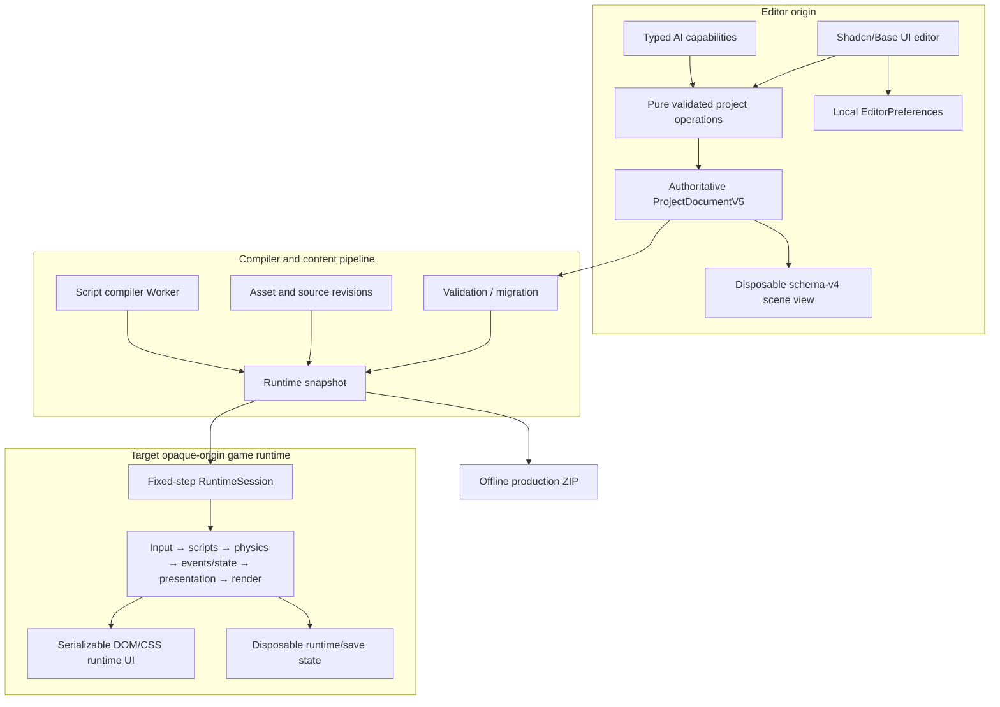

# ThreeJS Studio — Game Authoring Architecture

This document distinguishes the integrated product path from tested foundations. A serializable contract, editor panel, or packaged file is not considered a complete game feature until the same authored data works through Play, Stop/reopen, and offline export.

## Architectural objective



Four boundaries are non-negotiable:

1. `ProjectDocumentV5` contains authored, serializable state only.
2. `EditorPreferences` contains local theme, density, panel, workspace, and keymap state only.
3. Runtime/save state is disposable and cannot write back into authored data.
4. Authored code and project APIs receive no authoring bridge, React state, editor DOM, renderer handles, or storage handles. The target runtime owns only its opaque iframe DOM; the current trusted same-page v1 adapter is an explicit transition path, not a script API or security boundary.

## Current integration boundary

The authoritative-project migration has landed, but runtime convergence is incomplete.

### Integrated path

- `src/App.tsx` owns authoritative v5 persistence, revision/history snapshots, portable packages, game script commits, template replacement, and builds.
- `src/editor/gameProject.ts` derives the active scene as a schema-v4 compatibility view and merges legacy scene edits back into v5 without dropping v5-only records.
- `GameAuthoringWorkspace` is mounted from the activity rail and provides shadcn/Base UI Scripts, Input, Game UI, and Build tabs.
- Monaco Save uses a pure v5 script operation, an executable-code approval dialog, full validation, normal history, autosave, and one-step Undo.
- `ViewportEngine` prepares a disposable v5 `ProjectGameRuntime` when a project carries `threejs-studio.runtime-bindings.v1`, then drives it through `RuntimeSession`. The controller runs generalized input, Rapier, gameplay state/events, transforms/visibility, and the generic runtime-UI HUD without mutating authored data.
- Play supports the Collect & Escape core loop through keyboard, pointer/touch HUD controls, and gamepad polling; Pause/Step/restart/Stop retain fixed-tick and cleanup semantics. Projects without a runtime-binding manifest retain Rotate, Float, and Keyboard Move compatibility.
- The primary Build command produces a deterministic offline ZIP from the v5 snapshot, local Three.js/Rapier/runtime files, compiled project-script output, available model sources, and a local HUD stylesheet.
- The offline v1 adapter runs the Collect & Escape core loop with Rapier, keyboard/gamepad input, touch controls, score/countdown, win/fail/restart, diagnostics, and cleanup.

### Additive foundations

| Module | Implemented now | Product integration still required |
| --- | --- | --- |
| `editor/projectV5.ts` | V5 schema, deterministic v4 migration, validation, scene helpers | V5-native editing operations for every domain |
| `editor/gameProject.ts` | Strict v1–v5 loading and lossless legacy-scene adapter | Retire the projection after scene surfaces become v5-native |
| `editor/projectCommands.ts` | Atomic revision-checked command batches for v4 scene domains | V5 command registry and universal App/human/agent adoption |
| `editor/componentRegistry.ts` | Definitions for Rotate, Float, Keyboard Move | Physics, script, audio, animation, VFX, runtime-UI definitions and registry-driven Inspector/runtime |
| `runtime/RuntimeSession.ts` | Fixed scheduler, ordered systems, exact Step, diagnostics, restart/disposal | One compiled project runtime shared by Play, Preview, tests, and export |
| `runtime/RuntimePreviewHost.ts` | Tested opaque-origin iframe, lifecycle protocol, identity/sequence validation, throttled diagnostics, cleanup | Replace the current same-origin Play/Preview path |
| `runtime/ProjectGameRuntime.ts` | Validated v1 manifest adapter for input, Rapier, state/events, HUD, Collect rules, diagnostics, and cleanup; active in editor Play | General component/system compilation, authored behavior execution, non-Collect rules, opaque host, export reuse |
| `gameplay/input.ts` | Device-neutral button/axis resolver used by editor Play's v1 adapter | V5 settings operations/forms/tools and fully general browser mappings |
| `gameplay/physics.ts` | Rapier world/body/collider/sensor wrapper used by editor Play's v1 adapter | Registry entity components, full character controller, Inspector/debug UI, general runtime compilation |
| `gameplay/events.ts` / `state.ts` | Typed events, variables, queues, objectives/score/timers used by editor Play's v1 adapter | V5 operations, panels/tools, save schema, authored script/graph orchestration |
| `runtime-ui/` | Hardened accessible DOM/CSS renderer mounted for the editor's Collect HUD | Visual authoring, generalized binding adapters, and offline-runtime reuse |
| `scripting/` | SDK, virtual file system, esbuild-wasm compiler Worker/client, sandbox document/protocol | Script component instances, execution/hot reload/debugging in the shared runtime |
| `build/` | Deterministic ZIP, script packaging, local Three.js/Rapier modules, specialized offline Collect adapter/HUD | Model decoding, compiled behavior execution, generic runtime UI, exact Play/export parity |
| `components/studio/workspace/` | Serializable split-tree/panel registry, desktop/mobile shell components, preference sync tests | Replace the current hand-built workbench as the default shell |

## Authoritative ProjectDocumentV5

The durable schema contains:

- `scenes[]`, `startupSceneId`, and scene-local settings/root IDs.
- Stable entities with scene ownership, hierarchy, active/visible/locked state, tags, layers, transforms, components, and kind-specific payloads.
- Versioned prefab records and sparse instance overrides.
- A versioned asset union for models, textures, audio, materials, animations, environments, scripts, fonts, runtime UI, and general data.
- Generalized input maps with keyboard, pointer, touch, and gamepad bindings.
- Typed project variables and event channels.
- Serializable runtime-UI documents.
- Development, preview, and production build profiles.
- Explicit runtime permissions with a default-deny network policy.

V4 migration preserves existing project, node, component, asset, action, and binding IDs and creates deterministic scene/layer/input-map/build-profile records. V5 validation checks scene ownership, roots, hierarchy cycles, layers, asset records, component references, prefab links, input bindings, UI roots, build profiles, and permissions.

Save/autosave and portable packages use v5. `createLegacySceneView` is intentionally disposable; it exists only while the existing Hierarchy, Inspector, assets panel, and viewport still expect v4. `syncLegacySceneToV5` prevents those panels from erasing data they cannot represent.

Runtime/save-game values remain separate from this document. Play must never commit runtime transforms, score, timers, collision state, or spawned instances back into authoring history.

## Commands, transactions, and history

The target envelope is a bounded serializable transaction carrying an ID, project ID, optimistic base revision, label, typed commands, scope, and approval context. Execution must:

- Reject stale revisions rather than silently rebase.
- Validate the envelope and strict payloads before execution.
- Execute against a clone and validate the complete result.
- Apply every command or none.
- Increment the revision once.
- Return stable errors, warnings, affected records, bounded change paths, and an inverse.
- Use the same operation for human controls and typed tools.
- Coordinate source/binary staging with the document commit.

`projectCommands.ts` currently proves those semantics for v4 scene commands. It is a compatibility executor, not the v5-wide mutation bus. V5 script authoring already follows the same important guarantees through `gameAuthoring.ts`, and both human Save and typed game tools call that operation, but the common v5 command registry remains to be built.

## Component and system registries

Component definitions should own defaults, validation, migration, Inspector descriptors, runtime factories/keys, compatibility rules, diagnostics, and agent metadata. Equivalent registries are needed for asset kinds/importers, runtime systems, build actions, and visual-logic nodes.

Rotate, Float, and Keyboard Move are registered. Physics, behavior, animation, audio, VFX, runtime UI, and game-specific one-off data are not complete until they join the registry and pass contracts for validation, Inspector support, runtime support, migration, and AI metadata.

## Runtime state today

`RuntimeSession` provides a fixed 60 Hz simulation, at most five catch-up ticks per rendered frame, exact one-tick Step, ordered systems, pause/resume/restart, failure containment, serializable diagnostics, and reverse-order disposal.

The current `ViewportEngine` asynchronously prepares `ProjectGameRuntime` from a cloned v5 project before entering Play. The v1 adapter validates manifest references, creates `InputRuntime`, a Rapier `PhysicsWorld`, and `GameplayStateStore`, mounts the framework-free HUD, and sends runtime-only transform/active updates to the existing Three.js object map. It handles deterministic movement, pickups, a locked/unlocked exit, score/countdown, win/fail/restart, keyboard/pointer/touch/gamepad input, serializable HUD/diagnostics, and cleanup. Stop rebuilds authored transforms from the document.

This is meaningful gameplay-system convergence, but not runtime-host or arbitrary-program convergence. `ViewportEngine` still owns rendering and browser listeners in the editor origin. The controller implements a specialized v1 Collect-style tag/rule contract with an axis-aligned character-collision adapter; it does not execute the authored TypeScript behavior.

The required system order remains:

```text
input
→ scripts / graphs
→ physics
→ collision delivery / events
→ game state
→ animation / VFX / audio
→ camera / runtime UI
→ render
```

The next compiler/orchestrator must replace that specialized adapter with a general runtime snapshot, execute compiled behaviors/graphs, instantiate registry systems, and drive the same implementation in Play, Preview, tests, and export. Stop/restart/scene changes must continue disposing scripts/workers, timers, subscriptions, bodies/colliders, audio, assets, GPU resources, ports, and Blob URLs.

## Preview and script security

`RuntimePreviewHost` is implemented and browser-tested with an iframe equivalent to:

```html
<iframe
  sandbox="allow-scripts allow-pointer-lock"
  referrerpolicy="no-referrer"
  allow="gamepad"
  title="Game preview">
</iframe>
```

It omits `allow-same-origin`, applies a network-dark CSP, transfers initialization through a `MessageChannel`, rejects stale identity/sequence messages, throttles diagnostics, and removes ports/iframe state on disposal. It is additive: current Play and fullscreen Preview do not mount it yet.

The scripting package defines a Studio SDK, bounded virtual file system, worker-based `esbuild-wasm` compilation, diagnostic/source-map/content-hash results, and an opaque sandbox protocol. Behavior code is intended to use lifecycle hooks such as `onStart`, `onFixedUpdate`, `onUpdate`, actions/events/collisions, and `onDestroy` through stable serializable handles.

Monaco source persistence and build-time compilation are integrated. The v1 runtime adapter reads behavior-binding properties such as movement speed, but it does **not** load or execute the authored source or compiled bundle. Runtime script execution, component attachment, SDK autocomplete wiring, last-known-good hot reload in Play, watchdog termination, source-linked logs, and debugger features are not integrated.

Remote URLs, `file:` imports, dynamic remote imports, and undeclared npm packages remain disallowed. Executable-code changes and new permissions require visible approval.

## Generalized input, physics, events, and state

The input runtime supports button, 1D-axis, and 2D-axis actions; keyboard, pointer, touch, and gamepad bindings; prioritized contexts; consumption; scale/dead zones; and stable per-tick action state. `ProjectGameRuntime` feeds keyboard, pointer, touch, virtual HUD actions, and polled gamepads into this resolver, so the template mappings now drive editor Play. General Project Settings operations/forms/tools remain missing.

The Rapier wrapper supports serializable fixed/dynamic/kinematic bodies, box/sphere/capsule/cylinder colliders, sensors, friction/restitution, CCD, collision groups/events, transform reads, reset, removal, diagnostics, and disposal. The v1 editor adapter now orchestrates the template's bodies/sensors and uses an axis-aligned kinematic movement/collision layer. Registry-backed entity components, a general Rapier character controller, Inspector/debug rendering, and compilation of arbitrary projects remain open.

Events and gameplay state support versioned typed definitions, finite serializable values, deterministic ordering/ticks, bounded queues, listener-error isolation, variable defaults, reset, objectives, score, and timers. The editor v1 adapter routes Collect & Escape through these modules. The offline adapter implements equivalent serialized state directly; the two are not yet one shared implementation.

## Runtime UI

Runtime UI is deliberately not React, shadcn, or Base UI. Its standalone renderer supports serializable screen, stack, panel, text, image, button, progress, and input-prompt elements with safe-area/layout/breakpoint/focus data; literal, variable, locale, event, and action bindings; native semantics; accessible names; live regions; visible focus; and strict structural/CSS/reference limits.

The renderer owns and disposes a scoped DOM subtree, rejects sparse/deep payloads, avoids stealing canvas focus without explicit initial focus, caches/releases owned asset handles, and stops callbacks after reentrant disposal. The Game Authoring workspace summarizes v5 UI documents, and editor Play now mounts the Collect & Escape HUD with live variables and hold-style directional controls. The offline runtime validates/discovers the UI asset but currently mounts a separate minimal HUD. Visual authoring and one shared Play/export UI implementation remain required.

## Offline builds

The primary editor Build command now calls `buildOfflineZip` with:

- A production runtime projection of the authoritative v5 `project.json`; authoring-only TypeScript source catalogs are removed.
- Self-contained, version-locked local Three.js and `@dimforge/rapier3d-compat` modules.
- Compiled project scripts when source assets exist, stored as hashed, non-JavaScript artifacts. Bootstrap does not import or expose them to the main-realm runtime while the opaque behavior sandbox is pending.
- Available referenced model source bytes.
- A local CSP-safe HUD stylesheet.
- No production source maps, a network-dark CSP (`connect-src 'none'`), normalized paths, sorted deterministic entries, and SHA-256 hashes.

The resulting production ZIP declares no network dependencies and contains no CDN import. Its project is embedded as inert serialized data for bootstrap, so the game does not fetch its own manifest under the network-dark CSP. The legacy single-file HTML build remains an explicit compatibility option.

The packaged runtime validates/normalizes v4/v5 projects, selects the startup scene, renders primitives/lights/cameras, and runs a fixed scheduler. When it finds `runtime-bindings.v1`, it initializes local Rapier, a character controller, collision/sensor handling, keyboard/gamepad input, accessible hold-style touch controls, score/countdown, locked/unlocked exit, win/fail/restart, diagnostics, and cleanup. The targeted offline suite exercises keyboard win, gamepad movement, timeout, restart, HUD, and disposal.

This remains a specialized adapter rather than Play/export parity. It implements the template rules separately from `ProjectGameRuntime`, does not execute the packaged compiled behavior bundle, uses a purpose-built HUD instead of the generic runtime-UI renderer, and does not load packaged GLB/glTF model bytes. Deterministic packaging and a runnable Collect slice therefore do not yet prove the general shared runtime.

Production acceptance requires serving the ZIP from a non-root path with networking disabled and completing the same game checkpoints as Play.

## Shadcn/Base UI editor boundary

Shadcn controls editor chrome only. Generated source lives under `src/components/ui`; Studio composites live under `src/components/studio`. The preset owns semantic tokens while `--studio-*` covers brand, viewport, selection, gizmos, diagnostics, and density. Legacy CSS remains in a lower-priority cascade layer during migration.

All new game-authoring surfaces use generated shadcn/Base UI components. The current Menubar, command dialog, icon buttons/tooltips, Game Authoring workspace, and workspace-shell foundations are migrated. Much of the Hierarchy, Inspector, viewport toolbar, assets, console, Quick Start, Assistant, and default docking layout still uses legacy compositions.

Theme, density, panel sizes, workspaces, collapsed state, and keymaps belong to local `EditorPreferences`, never project history. Base UI semantics still require application-level labels, focus, contrast, keyboard behavior, and axe/browser tests.

## Collect & Escape vertical slice

The bundled template is a deterministic valid v5 project containing:

- A compact arena, player, ground/walls/obstacles, five pickups, an exit, camera, and lights.
- Keyboard, touch, and gamepad mappings.
- Serializable physics bodies, colliders, sensors, and collision layers.
- Variables/events for score, collected/required count, countdown, phase, pickup, exit, timeout, win, fail, and restart.
- A real TypeScript behavior source with exposed settings.
- An accessible responsive HUD/runtime-UI document and touch controls.
- A default-deny offline production build profile.

The editor can create, persist, reopen, inspect scripts/settings, play, stop, and package this project. Editor Play executes the v1 manifest through shared input/physics/state/runtime-UI modules; offline output executes an equivalent Rapier/input/state/HUD adapter. Both cover movement, pickups, score/countdown, the exit, win/fail/restart, and cleanup.

The authored TypeScript source is still descriptive rather than executable in both adapters. Because the editor and offline adapters are separate implementations and Play is not in the opaque host, this is a runnable vertical slice—not the final shared-runtime proof.

Acceptance still requires deterministic checkpoints for initial state, pickup collection, locked/unlocked exit, win, timeout failure, restart, Pause/Step, Stop restoration, reopen, and offline export. Keyboard, touch, and gamepad routes must reach equivalent gameplay checkpoints.

## Convergence order

1. Complete the legacy editor's shadcn migration and adopt the tested workspace shell.
2. Introduce a v5-native command registry and route human and agent mutations through it.
3. Generalize the v1 binding adapter into a compiled runtime snapshot and registry-backed systems.
4. Execute authored behavior bundles/graphs and add last-known-good reload/debugging.
5. Replace current Play/Preview with `RuntimePreviewHost` and complete teardown/security tests.
6. Make offline export consume that exact runtime/UI implementation and all required assets/WASM/decoders.
7. Pass the script-driven Collect & Escape journey end to end on desktop/mobile and with networking disabled.
8. Finish multi-scene/prefab/content workflows, professional workspaces, profiling, and ecosystem features.

Release gates test the complete playable artifact and human/AI contract parity, not the presence of panels or data fixtures alone.
